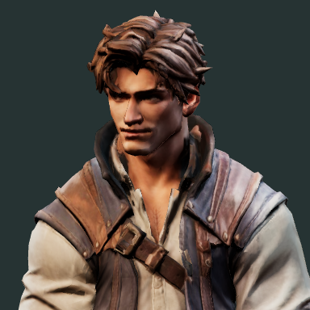

# Gemeinsamer Stil für Nebeljagd

Die feste Stilreferenz für neu erstellte Modelle ist der aktuelle, vom Nutzer
gelieferte Avatar `assets/characters/nebeljagd_player_base_v1.glb`.
Diese Vorgabe gilt für Gegenstände, Gebäude, Vegetation und weitere Figuren.
Die Referenzbilder anderer Spiele dienen ergänzend für Perspektive und Lesbarkeit.

## Form und Material

- Stilisierter Realismus mit glaubwürdiger Konstruktion, kräftigen Silhouetten,
  bewusst modellierten Formen und leicht betonten, abgerundeten Kanten.
- Große Formen und mittelgroße Details tragen das Design: Planken, Beschläge,
  Kleidungsfalten und Griffe bleiben aus der Spielkamera lesbar.
- Ruhige Flächen zwischen den Details. Feine Maserung, Poren und Kratzer bleiben
  dezent; die Dichte solcher Details orientiert sich am Avatar.
- Grundpalette: warmes Walnuss- und Lederbraun, gedämpftes Leinen/Beige,
  Schiefergrau, dunkles Eisen und sparsame Akzente aus gealtertem Messing.
  Regionen und Objektarten dürfen eigene Farben haben; Formensprache und
  Materialbehandlung bleiben zusammengehörig.
- Holz und Stoff überwiegend matt, Leder mit breiten weichen Glanzlichtern,
  Metall mit kontrollierten Reflexen. Abnutzung konzentriert sich auf
  Griffe, Verschlüsse und beanspruchte Ecken.
- Magische Effekte und Seltenheitsfarben werden im Spiel ergänzt. Ein
  Basismodell bleibt auch ohne diese Effekte klar erkennbar.

## Vorgehen bei Bildvorlagen und Tripo

Bei neuen Bildvorlagen immer eine tatsächliche Aufnahme des aktuellen Avatars
als Stilreferenz mitgeben. Die Vorlage für Tripo zeigt anschließend ausschließlich
das gewünschte Objekt auf neutralem Hintergrund, vollständig im Bild und ohne
Beschriftung. Avatar und Objekt nicht als gemeinsame Szene an die 3D-Erzeugung
übergeben: Die erzeugte Geometrie soll nur das gewünschte Objekt enthalten.

Wiederverwendbarer Stilzusatz für die Bildgestaltung:

> Match the supplied Nebeljagd avatar reference: premium stylized realism,
> sculpted readable forms, warm muted walnut and leather browns, linen neutrals,
> charcoal iron and restrained aged-brass accents. Broad calm surfaces with
> purposeful medium-scale details, subtle grain, selective edge wear and soft
> material highlights. Keep silhouette and construction readable from a
> top-down game camera. Render only the requested object, isolated on a neutral
> background, without text, other objects or magical effects.

Materialtexturen, Modellierung, Maßstab und Beleuchtung beeinflussen den
gemeinsamen Eindruck. Eine passende Bildvorlage allein garantiert noch kein
passendes fertiges 3D-Modell.

## Vergleich vor dem Einbau

Neue Modelle neben dem Avatar unter derselben Beleuchtung und Belichtung
prüfen: zuerst aus der normalen Spielkamera, anschließend in Nahansicht.
Auf Silhouette, Farbanteile, Detaildichte, Materialglanz und Größenverhältnis
achten. Unterschiedliche Studiohintergründe sind kein verlässlicher Vergleich
der Materialhelligkeit.

## Truhe als erstes Beispiel

Grundform, breite Metallbänder, gedeckte Farben und das kleine Blattmotiv
passen zur Referenz. Die erste Bildvorlage hatte zu viel feine Holzmaserung,
Metallflecken und flächendeckende helle Abriebkanten. Die überarbeitete Vorlage
reduziert diese Details zugunsten breiterer Formen und ruhigerer Oberflächen.
Deckel und Unterteil werden bei der späteren Modellaufbereitung getrennt.

Die Vorlage ist ein Bild für Tripo, noch kein importiertes oder animiertes GLB.
Prompt, Bild und Herkunftsnachweis liegen unter
`assets/concepts/chest/`. Bestehende Spielmodelle werden durch diese
Stilfestlegung nicht automatisch ersetzt.
