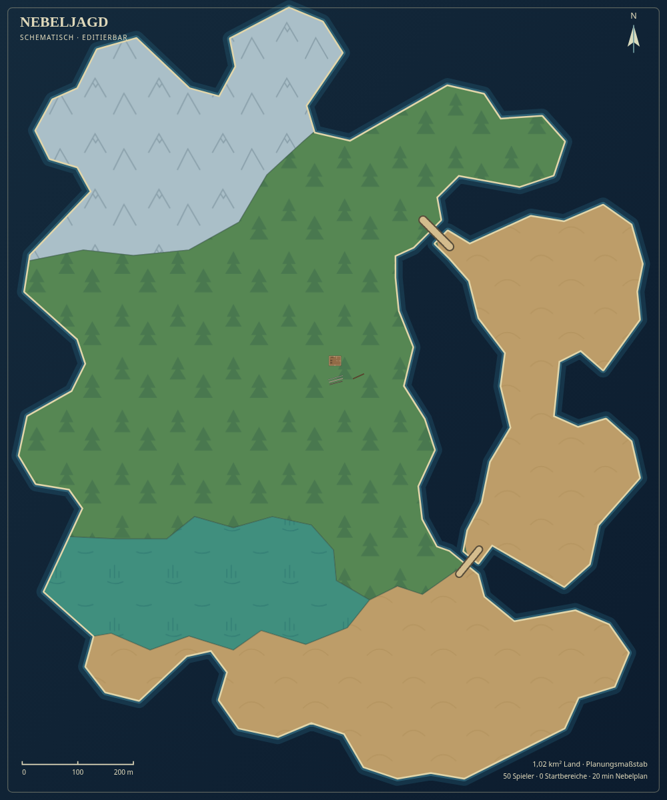

# Bereinigte Karte im Editor

Die akzeptierte Karte ist die Ausgangskarte des Editors und des Spiels.
Sie enthält weiterhin die beiden Landflächen, genau vier Biome (Schnee,
Grün/Wald, Wüste/Sand und Sumpf) und die beiden Brücken zur Ostinsel.

Die 17 provisorischen Orts-/Häusersymbole und zehn Spawn-Zonen sind aus den
Kartendaten entfernt: `places` und `spawnAreas` sind leer. Regionsbeschriftungen
und die Ansicht der Startbereiche sind beim Öffnen des Editors ausgeschaltet;
auch die mitgelieferte SVG enthält keine solchen Beschriftungen oder Kreise.
Die Biome behalten ihre internen Namen, damit sie im Editor auswählbar bleiben.

Das bereits platzierte Tripo-Wirtshaus, alle vier Mauer-/Zaunstrecken und die
gespeicherte Landschaft bleiben unverändert. Ebenso erhalten bleiben
Küsten, Biomgrenzen, Brücken, normaler Spielstart und Nebelplan.

## Öffnen

Browser-Link zur aktuellen Veröffentlichung:
[Bereinigten Editor öffnen](https://ohnoyoudie-dotcom.github.io/nebeljagd/preview/map-editor.html?v=df3b250).

Die aktuellen Dateien liegen auf `work` unter `welt/map-editor.html` und
`welt/magebrawl.html`. Der Editor beginnt eine neue Sitzung mit der bereinigten
Karte. Ein älterer eigener Entwurf wird durch diese Aktualisierung nicht
überschrieben. Zum Wechseln zunächst eigene Änderungen speichern und dann
die aktuelle `welt/worldmap.json` über **Öffnen** laden.

Karten mit bestehenden Ortsmarkern oder Startbereichen bleiben importierbar.
Die Validierung erlaubt jetzt ausdrücklich eine leere Startbereichsliste;
bei vorhandenen Startbereichen gelten weiterhin Geometrie-, Kapazitäts- und
Küstenprüfungen.

## Prüfung

Die vorhandenen Kartenprüfungen verwenden für generische Orts- und
Startbereichsvalidierung ausdrückliche Testdaten. Die aktuelle Ausgangskarte
wird auf leere Planungslisten und einen gültigen normalen Spielstart geprüft.
`npm test` besteht mit **304 von 304 Tests**; `npm run map:check` und
`npm run build` sind erfolgreich.
Die Browserprüfung der fertigen Editor-Datei kontrolliert die saubere
Ausgangsansicht, erhaltene Objekte, vier Biome, zwei Brücken, umschaltbare
Beschriftungen sowie JSON- und SVG-Export.

Alle **vier Browserprüfungen** sind bestanden, ohne Browserfehler oder externe
Anfragen. Bericht und Datei-/Bildprüfsummen:
[clean-map-check.json](clean-map-check.json).
