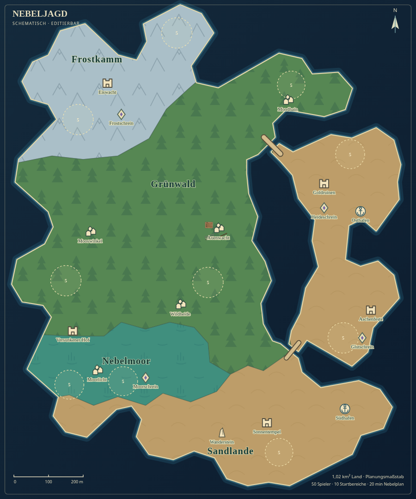

# Vier Biome und Brücken über freie Lücken

Dieser Bericht dokumentiert den Stand vor der anschließenden Bereinigung der
Kartensymbole, Regionsbeschriftungen und Spawn-Zonen. Die aktuelle Ausgangskarte
steht unter [Bereinigte Karte im Editor](clean-map.md); Geometrie und Brücken
dieses Berichts bleiben unverändert.

Die Karte enthält genau vier Regionen und vier Laufzeit-Biome:

| Region | Biom | Lage | Ungefährer Landanteil |
| --- | --- | --- | ---: |
| Frostkamm | Schnee (`snow`) | Nordwesten und nördliches Kap | 14,2 % |
| Grünwald | Grün/Wald (`forest`) | Großer zusammenhängender Inselkern | 44,1 % |
| Nebelmoor | Sumpf (`marsh`) | Südwesten und untere Mitte | 9,8 % |
| Sandlande | Wüste/Sand (`dunes`) | Südlicher Inselbogen und Ostinsel | 31,8 % |

Die Anteile sind auf eine Nachkommastelle gerundete Stichproben eines
Vier-Meter-Rasters. Wald und frühere Wiesen bilden eine gemeinsame grüne
Region; die frühere Goldheide und das Aschengebiet gehören jetzt zur Sandregion.
Die Regionspolygone decken die Landflächen ohne Lücken oder Überlagerungen ab.



## Echte Trennung der Landflächen

Die Hauptinsel liegt unter `island.points`, die östliche Insel als eigenständiges
Polygon unter `islets[0]` mit der ID `ostinsel`. Beide Küsten sind geometrisch
getrennt. Die früheren Flusskanäle und die polygonale Lagune sind vollständig
aus der Karte entfernt: `rivers` und `waterAreas` sind leer.

Zwischen den Küsten bleibt freier Raum mit dem allgemeinen Meereshintergrund.
Die Boden-Triangulation enthält dort kein Gelände. `paths` enthält ausschließlich
die beiden Brücken, die diesen Raum überspannen. Die Brücken sind beim Laufen
und Rollen die einzigen Verbindungen zwischen Hauptinsel und Ostinsel.

| Brücke | Decklinie | Deckbreite | Abstand der gegenüberliegenden Schnittufer |
| --- | --- | ---: | ---: |
| Nordbrücke | `[161, -324]` bis `[209, -276]` | 12 m | 24 m |
| Südbrücke | `[226, 313]` bis `[262, 269]` | 10 m | 18 m |

Alle vier Brückenenden liegen über zehn Meter von der nächsten Küste entfernt;
auch die gesamte Auflagenbreite liegt auf trockenem Land. Die bewährten
geformten Bodenanschlüsse unter den Brückendecks bleiben erhalten.

## Erhaltene Inhalte und Bearbeitung

Das Tripo-Wirtshaus, alle vier vorhandenen Mauer-/Zaunstrecken, die gespeicherte
Landschaft, der Spielstart und die Nebelregeln bleiben unverändert. Sämtliche
zehn Startkreise bleiben an ihren Positionen, vollständig auf trockenem Land,
mit insgesamt 50 Plätzen. Anzeigenamen der Startkreise folgen jetzt den vier
Biomen. Die vorhandenen Ortsmarker bleiben an ihren bisherigen Positionen.

Die gesamte Landfläche beträgt **1.016.012,57 m²**, also rund **1,02 km²**,
bei weiterhin 1.120 × 1.385 Metern Ausdehnung. Es wurden keine weiteren Straßen,
Gebäude oder alten Modelle platziert.

Im Editor lässt sich die Ostinsel unter **Mehr → Karteninhalt → Weitere Landflächen**
auswählen und über ihre Punkte bearbeiten. Hauptland, Ostinsel und Brücken
bleiben getrennt auswählbar. Bei einem älteren wiederhergestellten Entwurf die
aktuelle `welt/worldmap.json` über **Öffnen** laden; eigene Entwürfe vorher
speichern. Karten ohne `islets` bleiben gültig.

## Geometrieprüfung

`tests/two_access_island.test.js` prüft genau vier Biome, die leeren Fluss- und
Wasserflächenlisten, beide voneinander getrennten Landpolygone, vollständige
trockene Startkreise, echte Aussparungen in der Bodentriangulation und beide
Brücken über ihre gesamte nutzbare Breite.

Das Routing-Raster verwendet 0,8 Meter Körperreserve. Mit beiden Brücken ist
die gesamte begehbare Karte verbunden. Jede einzelne Brücke reicht, um die
Ostinsel zu erreichen. Werden beide Decks entfernt, bestehen genau zwei
begehbare Komponenten; es gibt keine dritte Landverbindung und keinen
unsichtbaren Bodensteg unter den Brücken.

Alle vier gezielten Kartenprüfungen bestehen. `npm run map:check` bestätigt
gültige Kartendaten und eine exakt daraus erzeugte `worldmap.svg`.

`npm test` besteht mit **304 von 304 Tests**, einschließlich älterer Karten
mit Flüssen und Wasserflächen sowie der neuen getrennten Landflächen.
`npm run build` erzeugt die geprüften Einzeldateien und das Offline-ZIP.

Acht Browserprüfungen der fertigen Dateien unter `welt/` bestehen:
vier Biome und sichtbare Brücken im Editor, Landflächen bearbeiten samt
Rückgängig/Wiederholen, Platzierung nur auf Land, JSON-Rundlauf und Import
einer älteren Karte, HTML-Export und erneutes Öffnen sowie beide Brückenquerungen
und die seitliche Begrenzung am Geländer. Die Querungen erfolgen mit normalen
WASD-Eingaben und jeweils einer Rolle über die Lücke. Alle vier Bodenanschlüsse,
die freien Brückenspannen und die Brückenanzeige in der Minikarte sind geprüft.

Bericht und Prüfsummen: [open-gap-check.json](open-gap-check.json).
Die Browserprüfung verwendet Chromium mit Software-WebGL; sie ist keine
Leistungsmessung auf einem physischen Tablet.

Reproduzieren mit einem HTTP-Server, der `welt/` als Wurzel ausliefert:

```sh
NEBELJAGD_URL=http://127.0.0.1:5208 python tests/open_gap_smoke.py
```

Die fertigen Browserdateien liegen auf dem Branch `work` unter `welt/`.
