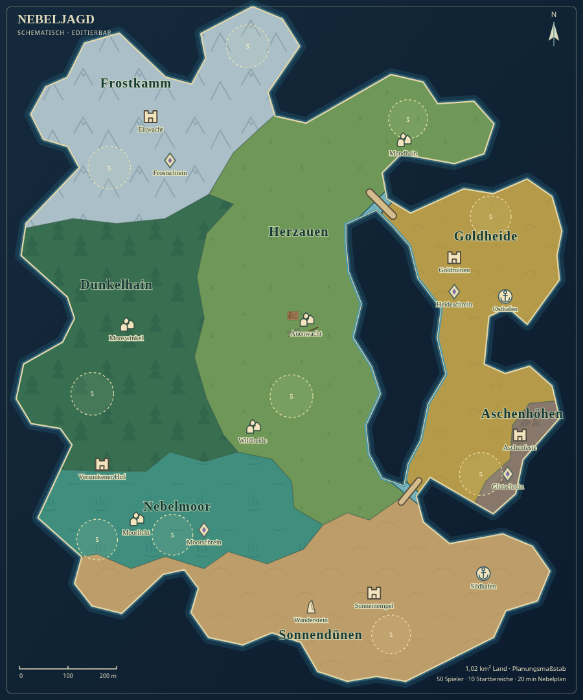

# Inselaufteilung nach der Kartenreferenz

Dieser Bericht dokumentiert den vorherigen Stand mit sieben Regionen und
zwei Flusskanälen. Die aktuelle Karte verwendet genau vier Biome und zwei
getrennte Landflächen mit Brücken über der freien Lücke:
[Vier Biome und offene Brücken](open-gap-layout.md).

Die neue Kartenbasis übernimmt die räumliche Gliederung der Vorlage: ein
kleineres Frostgebiet im Nordwesten, einen zusammenhängenden grünen Kern,
Moor im Südwesten und in der unteren Mitte, einen trockenen Süden und einen
über Wasser abgetrennten goldenen Ostbereich. Die sieben vorhandenen Regionen
und ihre Namen bleiben erhalten. Aschenhöhen ist jetzt ein kleiner Akzent am
südlichen Ostarm.

Die Lagune besitzt unterschiedlich breite Abschnitte und asymmetrische
Uferausbuchtungen. Zwei kurze Meeresdurchlässe öffnen sie nach Norden und Süden.
Die zwei bisherigen Landzugänge sind dadurch tatsächlich unterbrochen und
werden von **genau zwei Brücken** überquert. Die Nordbrücke verbindet Herzauen
mit Goldheide; die Südbrücke verbindet Sonnendünen mit Goldheide. Die vorhandene
Biome-Mischung sorgt im Spiel für weiche Farb- und Höhenübergänge.

Es wurden keine weiteren Straßen oder Flussnetze eingezeichnet. `paths`
enthält nur die beiden Brücken, `rivers` nur ihre zwei kurzen Meeresdurchlässe.
Die eigentliche Meerenge bleibt als bearbeitbare `waterAreas`-Fläche erhalten.
Die getrennte kleine Kreisinsel aus der Vorlage ist nicht Teil dieser Karte.

## Größen und Verteilung

Die Insel behält rund **1,02 km²** Landfläche und 1.120 × 1.385 Meter Ausdehnung.
Die Flächenanteile stammen aus einem Vier-Meter-Raster innerhalb der Küste,
abzüglich der polygonalen Lagune; die schmalen Kanalrinnen sind darin noch
Teil der geometrischen Landgrundfläche.

| Landschaft | Ungefährer Anteil | Lage |
| --- | ---: | --- |
| Frostkamm | 14,2 % | Nordwesten und nördliches Kap |
| Herzauen | 27,3 % | Zentrum und nordöstlicher Festlandsarm |
| Dunkelhain | 16,8 % | Westlicher grüner Kern |
| Nebelmoor | 9,8 % | Südwesten und untere Mitte |
| Sonnendünen | 17,8 % | Breiter südlicher Inselbogen |
| Goldheide | 12,8 % | Abgetrennter Ostbereich |
| Aschenhöhen | 1,3 % | Kleiner Akzent am südlichen Ostarm |

Die zwei grünen Landschaften bilden gemeinsam rund 44 % der Insel. Die
Regionspolygone teilen ihre Grenzpunkte; dadurch entstehen keine Lücken oder
Überlagerungen im Gelände. Regionsbeschriftungen wurden von den Ortsmarkern
abgerückt, damit die Übersicht lesbar bleibt.

## Brücken und Schutz der bestehenden Karte

| Querung | Decklinie | Breite | Wasserkanal |
| --- | --- | ---: | --- |
| Nordbrücke | `[161, -324]` bis `[209, -276]` | 12 m | 24 m breit, `[150, -265]` bis `[220, -335]` |
| Südbrücke | `[226, 313]` bis `[262, 269]` | 10 m | 18 m breit, `[200, 255]` bis `[288, 327]` |

Beide Decks reichen beidseitig mehr als zehn Meter über die Wasserbreite hinaus
auf festes Land. Kanalenden überlappen im Inneren die Lagune und außen das Meer.
Die Spielgeometrie verwendet denselben Meeresspiegel, passende Kanalbetten,
durchgängige Brückenrampen und seitliche Begrenzungen.

Das Tripo-Wirtshaus, alle vier vorhandenen Mauer-/Zaunstrecken, die gespeicherte
Landschaft, der Spielstart und die Nebelregeln bleiben unverändert. Alle zehn
Startkreise liegen vollständig auf trockenem Land und bieten weiterhin 50
Plätze. Ihre Positionen bleiben erhalten; zwei Anzeigenamen wurden an die neue
Biomverteilung angepasst. Einige reine Ortsmarker wurden in ihre jeweilige
Landschaft versetzt. Es wurden keine zusätzlichen Gebäude oder alten Modelle
platziert.

## Prüfungen

`tests/two_access_island.test.js` prüft die Daten, die ganzen Startkreise,
Brückenbreiten und Landauflagen sowie Lage, Größenverhältnis und lückenlose
Abdeckung der Biome. Ein Routing-Raster mit 0,8 Meter Körperreserve bestätigt:
Bei offenen Brücken ist die gesamte begehbare Insel verbunden. Jede einzelne
Brücke genügt, um den Osten zu erreichen. Ohne beide Decks zerfällt die
begehbare Fläche in genau zwei Bereiche; es gibt keinen dritten Zugang.

`tests/island_runtime.test.js` prüft die Küstentriangulation und die tatsächlich
verwendeten Biome. `tests/reference_bridges.test.js` prüft Meeresspiegel,
Kanalbetten, Brückenrampen, volle Laufbreite, seitliche Begrenzungen sowie
Laufen und Rollen neben den Brücken. Ein zusätzlicher Test prüft das tatsächlich
triangulierte Gelände unter der gesamten Deckbreite und an allen vier Auflagen.
Alle **290 Node-Tests**, `npm run map:check` und `npm run build` bestehen.

Die Bildkontrolle hatte an den Enden seitlich durch die Bretter ragenden Boden
aufgedeckt. Deshalb wird das echte Gelände unter der ganzen trockenen
Brückenbreite geformt und über weiche Ausläufe mit der Umgebung verbunden.
Deckprofile werden vorher aus dem ursprünglichen Gelände abgeleitet; das
Kanalbett bleibt unter Meereshöhe. Eine unabhängige Prüfung aller erzeugten
Geländedreiecke findet nach der Korrektur **keine Überschneidung an 11.775
Deckstichproben** und mindestens 3,53 cm Bodenfreiheit. Der größte Höhenschritt
quer über die vier Auflagen liegt bei 3,72 cm auf einer Strecke von 10 cm.
Die Korrektur erhöht die Anzahl der Geländedreiecke nicht.
[Messung vorher](reference-bridge-surface-before.json) ·
[Messung nachher](reference-bridge-surface-after.json).

Auf dem korrigierten Stand wurden **sechs Editorprüfungen** einschließlich
JSON- und HTML-Rundlauf sowie **drei gezielte Spielprüfungen** erneut ausgeführt.
Diese prüfen beide östlichen Auflagen beim normalen und seitlich versetzten
Verlassen sowie den Stopp an der Wasserseite der Nordbrücke. Die größten
beobachteten Höhenschritte liegen bei 5,4 cm im Norden und 3,8 cm im Süden.
Alle aktuellen Bilder zeigen vollständig freie Decks. Es gab keine
Browserfehler oder zusätzlichen externen Ressourcenanfragen.

[Prüfbericht mit HTML- und Bild-Hashes](reference-layout-check.json) ·
[Editor](reference-layout-editor.png) · [Nordauflage](reference-layout-north-bridge.png) ·
[Südauflage](reference-layout-south-bridge.png).
Die vorherigen vollständigen Brückenquerungen sind im Bericht ausdrücklich
als Nachweise des Builds vor der Bodenkorrektur gekennzeichnet. Die aktuelle
Browserprüfung verwendet Chromium mit Software-WebGL und trifft keine
Aussage zur Leistung auf einem Endgerät.

## Öffnen und Weiterbearbeiten

Die aktuellen Dateien liegen wie bisher unter `welt/map-editor.html` und
`welt/nebeljagd.html`. Bei einem wiederhergestellten älteren Entwurf die neue
`welt/worldmap.json` über **Öffnen** laden; eigene Entwürfe vorher speichern.
Ältere Karten bleiben ladbar und werden nicht automatisch umgeschrieben.
Die Aktualisierung wird auf `work` gesichert.

Brücken und Wasserkanäle lassen sich unter **Mehr → Karteninhalt** auswählen
und an ihren Punkten beziehungsweise Breiten bearbeiten. Die Lagune bleibt
eine eigene Gewässerfläche. Neue Objekt- und Grasplatzierungen halten die
Kanäle frei. Flussänderungen dürfen zuvor trockene Objekte und Startkreise
nicht überfluten; neue oder verschobene Startkreise werden vollständig gegen
die Kanalbreite geprüft.
